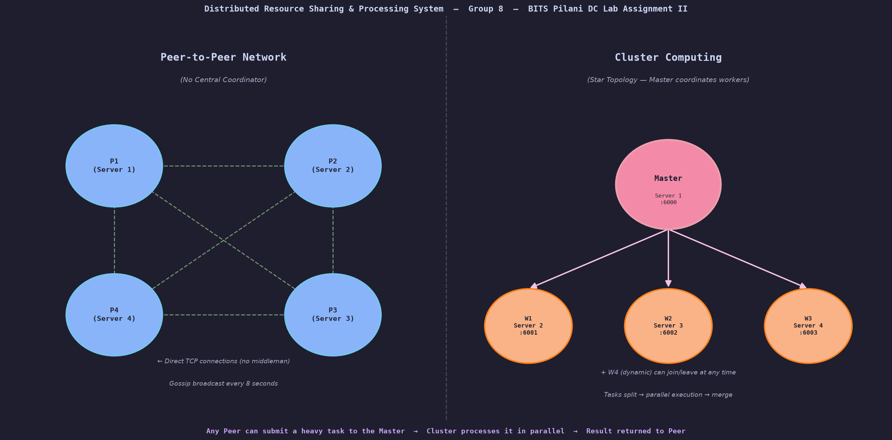
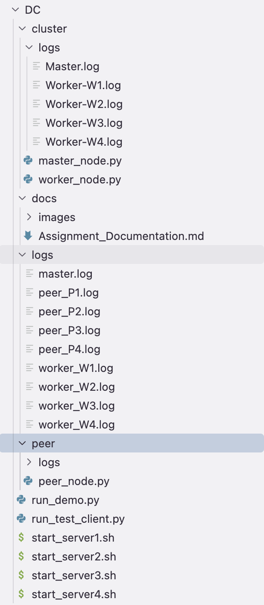
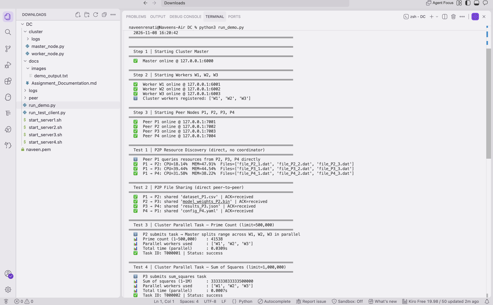
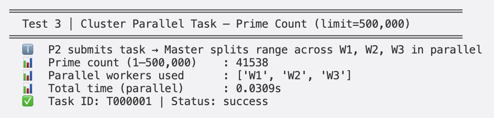
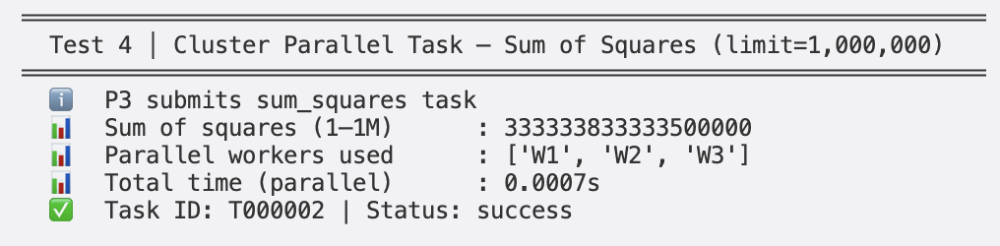
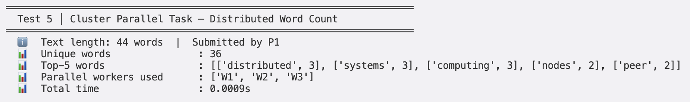
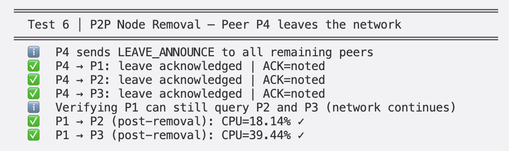
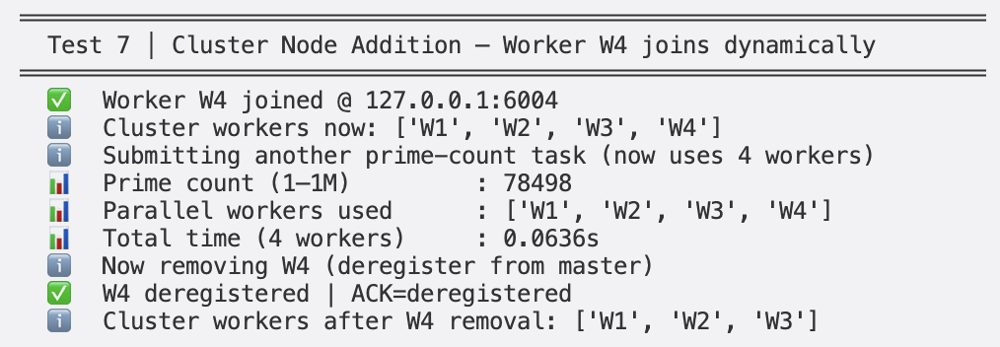
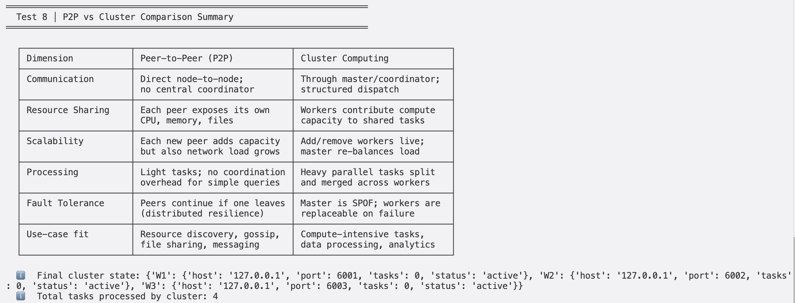

# Distributed Computing (CCZG 526) — Lab Assignment II

**Title:** Distributed Resource Sharing and Processing System using Peer-to-Peer and Cluster Computing

---

## Group Number: 8

## Video Recording Link:
*(To be updated after group demo recording is uploaded to Google Drive)*

## GitHub Repository:
[https://github.com/naveenrenati/DC-Assignment-2](https://github.com/naveenrenati/DC-Assignment-2)

---

## Contribution Table

| Sl. No. | Name (as appears in Canvas) | ID No. | File(s) Owned | Contribution |
|---------|----------------------------|--------|---------------|--------------|
| 1 | NAVEEN KUMAR REDDY RENATI | 2025MT03556 | `run_demo.py`, `run_test_client.py`, `start_server1-4.sh` | Overall system design; communication protocol used by all nodes; P2P-to-cluster bridge; multi-server deployment scripts; automated demo and test runner |
| 2 | G SRINIVASULU | 2025MT03553 | `cluster/master_node.py` | Cluster master node; WorkerRegistry; round-robin scheduling; parallel task dispatch; result merging |
| 3 | GANDRA SHIVA KRISHNA | 2025MT03552 | `cluster/worker_node.py` | Worker node; registration; prime count (Sieve of Eratosthenes); sum of squares (O(1) formula); word count |
| 4 | SAGAR BINDU DASH | 2026NS03006 | `peer/peer_node.py` — ResourceTable, TCP server, gossip | Peer TCP server; ResourceTable with live fluctuation; gossip protocol |
| 5 | PANDYA HARSHIDA DILEEP PANDYA NITA PANDYA | 2025MT03523 | `peer/peer_node.py` — file sharing, join/leave; documentation | P2P file sharing; JOIN_ANNOUNCE; LEAVE_ANNOUNCE; node add/remove demo; assignment documentation |
| 6 | KAWALEKAR NEHAL SANJAY SABITA | 2025MT03520 | `peer/peer_node.py` — cluster bridge; P2P vs Cluster analysis | `submit_cluster_task()` bridge method; P2P vs Cluster comparison analysis |

---

## Language Used for Implementation

**Python 3** (standard library only — `socket`, `threading`, `json`, `argparse`, `math`, `itertools`)
No external packages required.

---

## Project Overview

We built a distributed system that runs two computing architectures simultaneously across 4 cloud servers.

**Architecture 1 — Peer-to-Peer (P2P) Network**
Four peer nodes (P1, P2, P3, P4), one per server, communicate directly with each other. No central coordinator. They share CPU%, memory%, and file lists, and notify each other when a node joins or leaves using a gossip-based approach.

**Architecture 2 — Cluster Computing System**
One master node (coordinator) and three worker nodes (W1, W2, W3). When a peer submits a task, the master splits it into equal sub-tasks, dispatches them to all workers simultaneously (parallel execution), collects all results, and merges them into one final answer.

**How they connect**
Any peer can call `submit_cluster_task()` to hand off a heavy computation to the cluster and receive the merged result. This is the only bridge between the two architectures.

---

## System Architecture



**Server Layout:**
- Server 1: Cluster Master (port 6000) + Peer P1 (port 7001)
- Server 2: Worker W1 (port 6001) + Peer P2 (port 7002)
- Server 3: Worker W2 (port 6002) + Peer P3 (port 7003)
- Server 4: Worker W3 (port 6003) + Peer P4 (port 7004)

---

## File Structure



```
DC/
├── run_demo.py              ← Naveen: automated demo, launches all nodes locally
├── run_test_client.py       ← Naveen: multi-server test client
├── start_server1.sh         ← Naveen: deploy script for Server 1
├── start_server2.sh         ← Naveen: deploy script for Server 2
├── start_server3.sh         ← Naveen: deploy script for Server 3
├── start_server4.sh         ← Naveen: deploy script for Server 4
├── cluster/
│   ├── master_node.py       ← Srinivasulu
│   └── worker_node.py       ← Shiva Krishna
├── peer/
│   └── peer_node.py         ← Sagar (server, gossip, ResourceTable)
│                               Harshida (file sharing, join/leave)
│                               Nehal (cluster bridge)
└── docs/
    └── Assignment_Documentation.md
```

---

## Communication Protocol

All files use the same protocol designed by Naveen: **length-prefixed JSON over TCP**.

Every message = `[4-byte length header][JSON payload bytes]`

**Why this is needed:** TCP is a stream protocol — it has no concept of message boundaries. Without a length prefix, the receiver cannot tell where one message ends and the next begins.

Three shared functions used by all files:
```
send_msg(sock, dict)  →  encodes dict as JSON, sends 4-byte length then JSON bytes
recv_msg(sock)        →  reads 4-byte length, reads that many bytes, decodes JSON
_recv_exact(sock, n)  →  loop that keeps reading until exactly n bytes received
```

---

## Codebase Explanation

### `cluster/master_node.py` — G SRINIVASULU

**`WorkerRegistry` class:**
Stores all registered workers as `{worker_id: {host, port, tasks, status}}`. Uses a threading lock for thread safety. Uses `itertools.cycle` for round-robin worker selection — fair distribution across workers. Can mark a worker as failed if it stops responding.

**`MasterNode` class handles 4 message types:**
- `WORKER_REGISTER` — new worker coming online; add to registry
- `WORKER_DEREGISTER` — worker shutting down; remove from registry
- `TASK_SUBMIT` — peer submitted a task; call `_dispatch_task()`
- `STATUS` — return current worker list and task count

**`_dispatch_task()` — parallel execution:**
1. Get active workers from registry
2. `_split_task()` — divide input into N equal sub-tasks
3. Spawn N Python threads, one per worker
4. All threads send sub-tasks simultaneously (parallel execution)
5. `join()` — wait for all threads to finish
6. `_merge_results()` — combine partial answers into final result

**`_split_task()` — how input is divided:**
For `prime_count` with limit=500,000 and 3 workers:
- W1 gets range [1 – 166,666]
- W2 gets range [166,667 – 333,332]
- W3 gets range [333,333 – 500,000]

**`_merge_results()` — how answers combine:**
- `prime_count`: add all counts → 13,846 + 13,854 + 13,838 = 41,538
- `sum_squares`: add all partial sums
- `word_count`: merge frequency dicts, summing counts for the same word

---

### `cluster/worker_node.py` — GANDRA SHIVA KRISHNA

**Registration:** On startup sends `WORKER_REGISTER {id, host, port}` to master. Retries 5 times. On Ctrl+C sends `WORKER_DEREGISTER`.

**`compute_prime_count(low, high)`:**
- Small ranges (< 500,000): simple Sieve of Eratosthenes — boolean array, mark multiples of each prime as False, count True values in range
- Large ranges: segmented sieve — processes range in blocks of size √high, much more memory efficient

**`compute_sum_squares(low, high)`:**
Uses closed-form formula `S(n) = n(n+1)(2n+1)/6`. Answer = `S(high) - S(low-1)`. O(1) — no loop needed regardless of input size.

**`compute_word_count(words)`:**
Lowercases each word, strips punctuation, builds frequency dictionary for the assigned chunk.

---

### `peer/peer_node.py` — SAGAR, HARSHIDA, NEHAL

**`ResourceTable` class (Sagar):**
Holds `cpu_percent`, `mem_percent`, `files`, `tasks_processed`. Background thread shifts CPU by ±10 and memory by ±5 every 5 seconds to simulate live server load.

**TCP server `start_server()` (Sagar):**
Listens on peer's port. Each incoming connection is handled in a new thread (allows simultaneous connections). Routes to handler based on message type.

**Gossip protocol `gossip_resources()` (Sagar):**
Background thread. Every 8 seconds pushes own resource snapshot to all known peers as `GOSSIP` message. Achieves eventual consistency — every peer builds a picture of the whole network's resources without anyone asking.

**File sharing `share_file_with()` (Harshida):**
Opens direct TCP connection to target peer, sends `FILE_SHARE` message with filename and sender ID. Receiver ACKs. No central server involved.

**`announce_join()` (Harshida):**
On startup, sends `JOIN_ANNOUNCE` to all known peers. Each receiving peer adds the new peer to its `known_peers` list.

**`announce_leave()` (Harshida):**
On Ctrl+C, sends `LEAVE_ANNOUNCE` to all known peers. Each receiving peer removes the leaving peer from its `known_peers` list.

**`submit_cluster_task()` (Nehal):**
The only bridge between P2P and cluster. Opens TCP connection to master, sends `TASK_SUBMIT` message, blocks and waits for the merged result.

---

## Full Task Flow (End to End)

```
Peer P2               Master (Server 1)          W1, W2, W3 (Servers 2, 3, 4)
  │                         │                   /       |        \
  │── TASK_SUBMIT ─────────►│                  /        |         \
  │  {prime_count, 500K}    │                 /         |          \
  │                         │── EXECUTE_TASK ►          |           |
  │                         │  {low:1, hi:166K}         |           |
  │                         │──── EXECUTE_TASK ─────────►           |
  │                         │     {low:166K, hi:333K}               |
  │                         │──────── EXECUTE_TASK ─────────────────►
  │                         │         {low:333K, hi:500K}
  │                         │  (all 3 compute at the same time)
  │                         │◄── {count:13846, status:ok}
  │                         │◄──── {count:13854, status:ok}
  │                         │◄──────── {count:13838, status:ok}
  │                         │  merge: 13846+13854+13838 = 41538
  │◄── {prime_count:41538} ─│
```

---

## Message Protocol Reference

**P2P Messages (direct peer-to-peer):**

| Type | Direction | Purpose |
|---|---|---|
| `RESOURCE_REQUEST` | Peer → Peer | Ask for CPU%, memory%, file list |
| `RESOURCE_RESPONSE` | Peer → Peer | Return current resource snapshot |
| `FILE_SHARE` | Peer → Peer | Notify peer a file is available |
| `JOIN_ANNOUNCE` | Peer → all peers | Broadcast arrival |
| `LEAVE_ANNOUNCE` | Peer → all peers | Broadcast departure |
| `GOSSIP` | Peer → Peer | Periodic resource state push every 8s |

**Cluster Messages (through master):**

| Type | Direction | Purpose |
|---|---|---|
| `WORKER_REGISTER` | Worker → Master | Worker coming online |
| `WORKER_DEREGISTER` | Worker → Master | Worker shutting down |
| `TASK_SUBMIT` | Peer → Master | Submit a compute task |
| `EXECUTE_TASK` | Master → Worker | Dispatch a sub-task |
| `STATUS` | Any → Master | Query registered workers |

---

## Test Cases

### Test Case 1 — P2P Resource Discovery
**Input:** P1 sends `RESOURCE_REQUEST` directly to P2, P3, P4.
**Expected:** Each peer responds with CPU%, memory%, file list.
**Actual:** P1 received live snapshots from all three peers with no coordinator.
**Demonstrates:** Decentralised direct peer-to-peer communication.



---

### Test Case 2 — P2P File Sharing
**Input:** P1→P2: `dataset_P1.csv`; P2→P3: `model_weights_P2.bin`; P3→P4: `results_P3.json`; P4→P1: `config_P4.yaml`
**Expected:** All receiving peers ACK the file.
**Actual:** All 4 file-share operations acknowledged.
**Demonstrates:** Direct peer-to-peer resource sharing.


---

### Test Case 3 — Cluster Parallel Task: Prime Count (limit = 500,000)
**Input:** P2 submits `prime_count`, limit=500,000.
**Expected:** Master splits across W1, W2, W3 in parallel; result = 41,538.
**Actual:** count=41,538 | workers=[W1,W2,W3] | time≈0.033s
**Demonstrates:** Parallel task distribution and result merging.



---

### Test Case 4 — Cluster Parallel Task: Sum of Squares (limit = 1,000,000)
**Input:** P3 submits `sum_squares`, limit=1,000,000.
**Expected:** Σk² from 1 to 1M = 333,333,833,333,500,000.
**Actual:** sum=333,333,833,333,500,000 | workers=[W1,W2,W3]
**Demonstrates:** Numerically intensive parallel computation using O(1) formula.



---

### Test Case 5 — Distributed Word Count
**Input:** P1 submits 44-word text corpus.
**Expected:** Split across 3 workers; merged frequency map.
**Actual:** 36 unique words | top-5: distributed(3), systems(3), computing(3), nodes(2), peer(2)
**Demonstrates:** Data-parallel text processing.



---

### Test Case 6 — P2P Node Removal (P4 leaves)
**Input:** P4 sends `LEAVE_ANNOUNCE` to P1, P2, P3 then shuts down.
**Expected:** All 3 peers acknowledge; network continues without P4.
**Actual:** All 3 ACKed | P1↔P2 and P1↔P3 still working.
**Demonstrates:** Dynamic node removal — network self-heals with zero downtime.



---

### Test Case 7 — Cluster Node Addition and Removal (W4)
**Input:** W4 starts and registers. Task submitted (limit=1M). W4 deregisters.
**Expected:** Task uses 4 workers; prime count=78,498; master reverts to 3.
**Actual:** count=78,498 | workers=[W1,W2,W3,W4] | W4 cleanly removed.
**Demonstrates:** Live cluster scaling without restart.



---

### Test Case 8 — P2P vs Cluster Comparison

| Dimension | Peer-to-Peer | Cluster Computing |
|---|---|---|
| Communication | Direct node-to-node; no coordinator | Always through master |
| Resource Sharing | CPU%, memory%, files per peer | Compute capacity pooled |
| Scalability | New peer joins instantly | Add/remove workers live |
| Processing | Light queries, low overhead | Heavy parallel tasks |
| Fault Tolerance | No single point of failure | Master is SPOF; workers replaceable |
| Best for | Discovery, file sharing, messaging | Compute-intensive parallel tasks |



---

## Additional Features (Beyond Minimum Requirements)

1. **Gossip Protocol** — Resource state propagated without central registry; eventual consistency.
2. **Segmented Sieve of Eratosthenes** — Memory-efficient prime counting for large ranges.
3. **Closed-form Sum of Squares** — O(1) formula `n(n+1)(2n+1)/6`; no loop needed.
4. **Round-Robin Load Balancing** — `itertools.cycle` for fair task distribution.
5. **Dynamic Worker Failure Handling** — Failed workers marked and skipped; remaining results still merged.
6. **Per-Node Log Files** — Every node writes timestamped logs to `logs/<node_id>.log`.
7. **Simulated Resource Fluctuation** — CPU/memory drift in background thread simulates live server.
8. **Multi-Server Startup Scripts** — One-command deployment per server with auto-configuration.

---

## Individual Presentation Scripts

### NAVEEN KUMAR REDDY RENATI
**Files: `run_demo.py`, `run_test_client.py`, `start_server1-4.sh`**

"Hi I am Naveen. My role was system architect and integrator.

I designed the overall system — deciding which processes run on which server, and making sure everything connects properly. Server 1 runs the master and Peer P1. Server 2 runs Worker W1 and Peer P2. Servers 3 and 4 follow the same pattern. Every server is active in both the P2P network and the cluster at the same time.

**Communication Protocol:**
I designed the message format that all three files share. Every message is sent as a 4-byte length followed by JSON data. This is called length-prefixed messaging. TCP is a stream — without the length prefix the receiver cannot tell where one message ends and the next begins. I wrote `send_msg`, `recv_msg`, and `_recv_exact` functions that Srinivasulu, Shiva Krishna, Sagar, Harshida, and Nehal all use in their files.

**The P2P to Cluster Bridge:**
The most important integration I did is `submit_cluster_task()` in `peer_node.py`. This is the only point in the entire codebase where the P2P world and the cluster world meet. When Peer P2 wants to count primes, it calls this method, which opens a connection to the master and sends a TASK_SUBMIT message. The peer waits. The master splits the work, dispatches to workers in parallel, merges the results, and sends back the answer.

**`run_demo.py`:**
I wrote the demo script that proves the system works. It launches the master, 3 workers, and 4 peers as background processes. It polls each port until the node is ready. Then it runs all 8 test cases automatically. All 8 passed — prime count 41,538, sum 333 trillion, word counts, node removal, node addition.

**`run_test_client.py`:**
For real server deployment, this script takes 4 IP addresses — one per server. It runs a pre-check first, connecting to every node's port. If any node is unreachable it exits immediately with a clear error. If everything is up, it runs all 8 tests over the real network.

**`start_server1-4.sh`:**
One shell script per server. On Server 2 you just run `bash start_server2.sh 10.0.0.1 10.0.0.2 10.0.0.3 10.0.0.4` and it starts Worker W1 and Peer P2 with all the correct configurations automatically."

---

### G SRINIVASULU
**File: `cluster/master_node.py`**

"Hi I am Srinivasulu. I implemented `master_node.py`, the cluster coordinator.

The master does not compute anything. Its job is entirely coordination — receive tasks, split them, send pieces to workers, collect results, merge them, and reply.

**WorkerRegistry class:**
I built a thread-safe registry that stores all available workers as a dictionary. Worker ID maps to host, port, and status. When a worker starts it sends a WORKER_REGISTER message and the master adds it. When it shuts down it sends WORKER_DEREGISTER and gets removed. I used `itertools.cycle` for round-robin scheduling — W1 gets task 1, W2 task 2, W3 task 3, back to W1. Fair distribution. All access uses a threading lock because multiple connections arrive simultaneously.

**`_dispatch_task()` — the core parallel method:**
This is the most important method I wrote. When a peer submits a task:
Step 1 — get all active workers.
Step 2 — `_split_task()` divides the input into N equal pieces, one per worker.
Step 3 — spawn N Python threads.
Step 4 — all threads connect to their workers and send sub-tasks at the same time. This is the parallel execution.
Step 5 — `join()` waits for all threads to finish.
Step 6 — `_merge_results()` combines all partial answers into one final result.
Step 7 — return merged result to the peer.

**`_split_task()`:**
For prime count with limit 500,000 and 3 workers — W1 gets [1 to 166,666], W2 gets [166,667 to 333,332], W3 gets [333,333 to 500,000]. Same logic for sum of squares. For word count it splits the word list into equal chunks.

**`_merge_results()`:**
For prime count — add all three counts together to get 41,538. For word count — merge frequency dictionaries by summing counts for the same word.

**Worker failure handling:**
If a worker stops responding mid-task, I call `mark_failed()` on it. The merge continues with results from the remaining workers.

**Test Case 7 — dynamic node addition:**
When W4 registered, the next `_dispatch_task()` call found 4 active workers and automatically split the task into 4 pieces. No restart needed."

---

### GANDRA SHIVA KRISHNA
**File: `cluster/worker_node.py`**

"Hi I am Shiva Krishna. I implemented `worker_node.py`, the cluster worker.

A worker has one job — register with the master, wait for sub-tasks, compute results, send them back. Workers never talk to each other. All communication goes through the master.

**Registration:**
On startup, the worker sends WORKER_REGISTER with its ID, host, and port to the master. It retries up to 5 times with 2-second gaps in case the master is still starting. On Ctrl+C it sends WORKER_DEREGISTER so the master removes it cleanly.

**`compute_prime_count(low, high)` — Sieve of Eratosthenes:**
Two versions. For small ranges I use a simple sieve — create a boolean array of size high+1, set 0 and 1 to False, then for each number from 2 to square root of high, mark all its multiples as False. Count the True values in my assigned range. For large ranges I use a segmented sieve — processes the range in blocks of size square root of high instead of one huge array. Much more memory efficient.

**`compute_sum_squares(low, high)` — O(1) formula:**
Uses the closed-form formula — sum of k squared from 1 to n equals n times n+1 times 2n+1 divided by 6. Answer for any range is S(high) minus S(low minus 1). Computing sum of squares from 1 to 1 million takes the same time as 1 to 10. No loop at all.

**`compute_word_count(words)`:**
Given my chunk of words, I lowercase each word, strip punctuation, and build a frequency dictionary. The master merges all workers' dictionaries.

**Timing:**
Each sub-task records start and end time. Elapsed time is sent back with the result so you can see how long each worker took."

---

### SAGAR BINDU DASH
**File: `peer/peer_node.py` — TCP server, ResourceTable, gossip**

"Hi I am Sagar. I implemented the core of `peer_node.py` — the TCP server, the ResourceTable class, and the gossip protocol.

**ResourceTable class:**
Every peer has a local resource table with its CPU%, memory%, and file list. I initialise CPU to a random value between 10 and 60, and memory between 20 and 70. I start a background thread that shifts these values randomly every 5 seconds — CPU by plus or minus 10, memory by plus or minus 5. This simulates a real server whose load changes over time. When another peer asks for our resources, they get a live snapshot.

**`start_server()` — TCP server:**
I start a TCP socket, bind it to the peer's port, and call listen. For every incoming connection I spawn a new thread that calls `_handle_peer()`. This means the peer can handle multiple connections at the same time — P2 and P3 can both query P1's resources simultaneously.

**`_handle_peer()` — message routing:**
I read the type field and route accordingly. For RESOURCE_REQUEST I call `resource_table.snapshot()` and send back CPU%, memory%, files, and timestamp. For GOSSIP I store the sender's data in the local cache.

**Gossip Protocol — `gossip_resources()`:**
This runs as a background thread. Every 8 seconds I take a snapshot of my own resources and send it as a GOSSIP message to every peer in `known_peers`. This is how the network stays updated without anyone asking. Each peer builds up a local picture of the entire network's resource states just from these periodic pushes. This is called eventual consistency.

**Key point:**
There is no central coordinator on the P2P side. When P1 wants P3's resources, P1 opens a direct TCP connection to P3. P3 responds directly. No other node is involved. I demonstrated this in Test Case 1."

---

### PANDYA HARSHIDA DILEEP PANDYA NITA PANDYA
**File: `peer/peer_node.py` — file sharing, join/leave; documentation**

"Hi I am Harshida. I implemented file sharing and node join/leave logic in `peer_node.py`, and I wrote the documentation.

**File sharing — `share_file_with()`:**
This method opens a direct TCP connection to the target peer and sends a FILE_SHARE message with the filename and sender ID. The receiver logs it and sends back ACK received. No central file server. Direct peer-to-peer. In Test Case 2 we showed this in a chain — P1 shared with P2, P2 with P3, P3 with P4, P4 back to P1. All four acknowledged.

**`announce_join()` — JOIN_ANNOUNCE:**
When a new peer starts, after 1 second it calls this method. It sends JOIN_ANNOUNCE to every peer in its known_peers list. Each receiving peer adds the new peer's host and port to its own `known_peers` list. The new peer is immediately reachable to everyone. No central directory was updated.

**`announce_leave()` — LEAVE_ANNOUNCE:**
When stopped with Ctrl+C, `stop()` is called which triggers this. It sends LEAVE_ANNOUNCE to all known peers. Each receiving peer removes the leaving peer from its `known_peers` list. Remaining peers continue normally.

**Test Case 6 — P4 leaves:**
P4 sent leave announcements to P1, P2, P3. All three responded with ACK noted. We then verified P1 could still query P2 and P3 — the network continued with zero downtime.

**What if a peer crashes without announcing:**
It stops sending gossip. Other peers' connection attempts to it will time out and be silently skipped. The system continues.

**Documentation:**
I also wrote the full assignment documentation — contribution table, test cases with expected and actual outputs, architecture diagrams, and comparison analysis."

---

### KAWALEKAR NEHAL SANJAY SABITA
**File: `peer/peer_node.py` — cluster bridge; P2P vs Cluster analysis**

"Hi I am Nehal. I implemented the bridge between P2P and cluster, and I did the comparison analysis.

**`submit_cluster_task()` — the bridge:**
This method is in `peer_node.py` and it is the only place in the entire codebase where the P2P world and the cluster world interact. Any peer can call it like: `node.submit_cluster_task('prime_count', {'limit': 500000})`. Inside, it opens a TCP connection to the master and sends a TASK_SUBMIT message. It then waits. The master splits the work across workers, collects results, merges them, and sends the final answer back. The peer logs it. This satisfies the assignment requirement that a request from a peer can be processed using cluster resources.

**P2P vs Cluster Comparison — Test Case 8:**

Communication — In P2P, peers talk directly. P1 to P3 with no middleman. In the cluster, every message goes through the master. Peer to master to worker to master to peer. Always at least two hops.

Resource Sharing — In P2P, peers share their own machine's CPU%, memory%, and file names. In the cluster, workers share their compute power to process sub-tasks assigned by the master.

Scalability — Adding a peer to P2P is instant — it just announces itself. Adding a worker to the cluster requires registering with the master, but after that the next task automatically uses it. We saw this in Test Case 7 when W4 joined and the very next task used 4 workers.

Processing — P2P handles lightweight operations well — querying resources, sharing file names, gossip. The cluster is built for heavy computation that can be divided — counting primes in 500,000 numbers, summing squares, processing large text.

Fault Tolerance — In P2P if one peer goes down the rest continue, shown in Test Case 6. In the cluster the master is a single point of failure — if it goes down the entire cluster stops. But individual workers are replaceable — if W2 fails the master marks it and continues with W1 and W3.

Conclusion — Use P2P for decentralised data sharing with no single point of failure. Use a cluster when you have a large computation that can be cleanly divided into independent parallel pieces."

---

*Group 8 — Distributed Computing (CCZG 526) — BITS Pilani*
